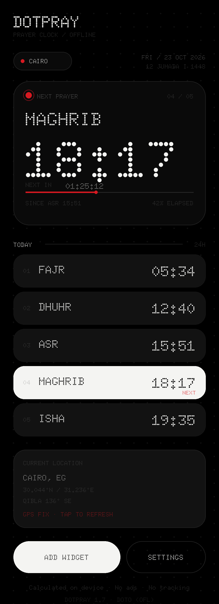
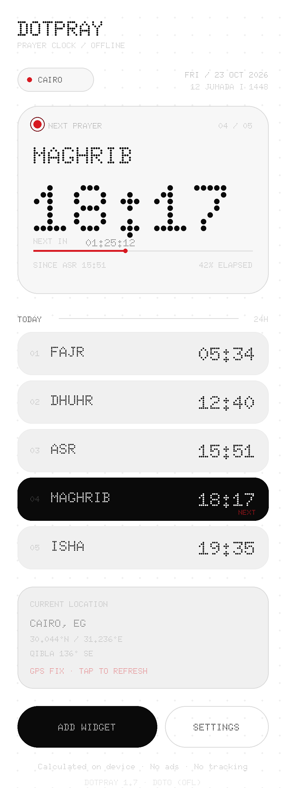
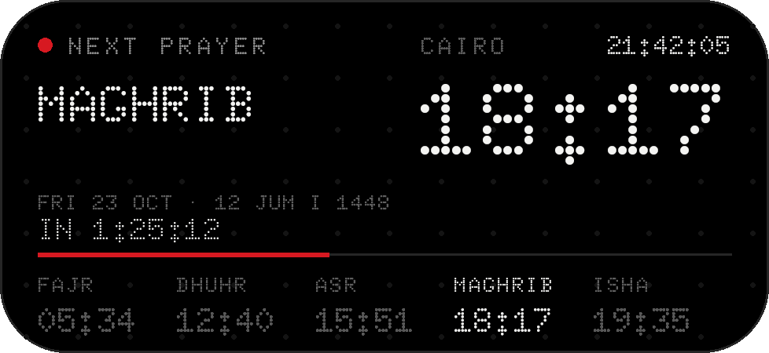
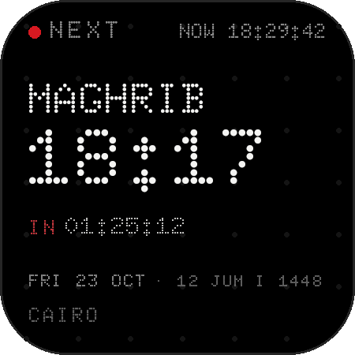

# Dotpray

A Nothing OS–styled Android prayer clock, built around a **home-screen widget**.

Monochrome dot-matrix aesthetic, one red accent, everything computed on device.
No ads, no tracking, no AndroidX. The app has no `INTERNET` permission.

<p align="center">
  
</p>

<p align="center">
  
  
  
  
</p>

*Previews are design mock-ups rendered from the real layouts
(`tools/render_preview.py`), not screenshots. The app and both widgets share
the in-app System / Light / Dark choice.*

*Version 1.7 — cleaner widget hero, dotted live seconds and Umm al-Qura dates.*

---

## What it does

| | |
|---|---|
| **Live prayer clock** | Next prayer, its time, and a ticking `HH:MM:SS` countdown |
| **Two widgets** | Wide `4×2` and compact `2×2`; a live wall clock with seconds and a live `HH:MM:SS` countdown (Android 12+), plus the Hijri date |
| **Fixed method** | Egyptian General Authority of Survey — Fajr 19.5° / Isha 17.5° |
| **Asr schools** | Standard (Shafi'i/Maliki/Hanbali) or Hanafi (shadow factor 2) |
| **Current location** | GPS fix, rechecked every 15 minutes while the app is open, named by the system geocoder with a nearest-city fallback |
| **Hijri date** | Umm al-Qura calendar through the platform chronology |
| **Qibla** | Great-circle bearing to the Kaaba from your coordinates |
| **Prayer alerts** | Notification at each prayer time, survives reboot and time-zone changes |
| **12 / 24 hour** | Switchable, on the device and in the widget |
| **System / Light / Dark** | A three-way switch that repaints the app and both widgets |
| **Nothing styling** | Pure black in dark mode, paper white in light mode, hairline borders, dot-matrix backdrop, dot-matrix type throughout, one red accent |

Everything works offline. The app asks for `ACCESS_COARSE_LOCATION` /
`ACCESS_FINE_LOCATION` to centre the times on the current fix, and it has no
`INTERNET` permission. On first launch it asks for a fix, then re-checks the
current location every 15 minutes while the app is open and whenever the app
resumes after the saved fix is more than 15 minutes old. The location pill
on the main screen still forces an immediate refresh. A fix is named through
the platform geocoder; if the device is offline it falls back to the nearest
bundled city within 150 km. Before the first fix, Cairo is used as a neutral
starting point.

---

## Installing

Download the latest signed APK from the repository's **Releases** page, or
build it locally with `./build.sh`:

```bash
./build.sh
adb install -r dist/dotpray-1.7.apk
```

Or copy the built APK to the phone and open it (you will need to allow
"install from unknown sources" once).

The APK is **universal**: the app is pure Java with no native libraries, so the
same file runs on 32-bit and 64-bit ARM devices, and on x86 emulators. The only
floor is Android 8.0 (API 26), not the CPU architecture. `build.sh` audits this
and refuses to ship an APK that carries native code for only one half of an
architecture family.

**Adding the widget:** long-press an empty spot on the home screen → *Widgets* →
*Dotpray* → drag the **Prayer** (wide) or **Prayer Small** (compact) widget out.

Or use the **ADD WIDGET** button inside the app, which asks the launcher to pin
it for you.

The moving seconds in the wall clock and next-prayer countdown are Doto glyph
vectors inside `ViewFlipper`s. The launcher advances those tiny views itself,
so the seconds stay live even when the app is not running, without a service or
a per-second alarm. The bitmap (next prayer, Hijri date, progress, prayer strip)
still redraws on every minute boundary (a non-wakeup `RTC` alarm, exact when the
OS allows it and `setAndAllowWhileIdle` otherwise), immediately when the device
is unlocked, on every prayer boundary, on resize, on boot, whenever the clock
or the time zone changes, and immediately when the app's theme choice or
location changes.

---

## Building

There is **no Gradle wrapper and no Android Gradle Plugin** in this repo. The
build is a straight pipeline of the platform tools, which keeps it reproducible
on any machine that has an Android SDK and a JDK:

```bash
SDK=/opt/android-sdk JAVA=/opt/jdk ./build.sh
```

`build.sh` runs:

```
aapt2 compile  →  aapt2 link  →  javac  →  d8  →  zip  →  zipalign  →  apksigner
```

Requirements:

| Tool | Version used here |
|---|---|
| JDK | 17 (Temurin) |
| Android platform | `android-37.0` (`android.jar`) |
| Build tools | `37.0.0` |
| minSdk / targetSdk | 26 / 35 |

Output: `dist/dotpray-1.7.apk`, signed with a debug key that is generated on
first run at `keystore/dotpray.keystore` (outside `build/`, so rebuilds keep the
same certificate and new versions install over old ones).

Two details worth knowing if you touch the build:

* Java sources are compiled with `javac --release 8 -classpath android.jar`,
  **not** `-bootclasspath`. With `-bootclasspath` the lambdas fail to resolve
  (`cannot find symbol: method metafactory`); with `--release 8` the Java 8 API
  surface is enforced and D8 desugars the lambdas afterwards.
* `Api30.java` is deliberately the only file that touches API 30 APIs, and it
  is compiled against the API 37 `android.jar`. Every other source file
  compiles cleanly against a real **API 26** `android.jar`.

---

## How the times are computed

`prayer/PrayerCalculator.java` implements the NOAA solar position algorithm:

1. Equation of time and solar declination from the mean longitude, mean anomaly
   and the corrected obliquity of the ecliptic.
2. True solar noon: `720 − 4·longitude − EoT` minutes after `00:00 UTC`.
3. Hour angle for each twilight depression:
   `cos H = (sin h − sin φ · sin δ) / (cos φ · cos δ)`, offsets `±4·H` minutes.
4. Asr from the shadow length: `tan h = 1 / (shadowFactor + tan|φ − δ|)`.
5. Sunrise/sunset use the standard `-0.833°` refraction-corrected altitude.
6. Everything is computed in UTC and converted to local time at the very end,
   so a DST boundary can never shift a prayer by an hour.

**High latitudes.** When the sun never reaches the requested depression (the
midnight sun region), Fajr and Isha fall back to *one seventh of the night*,
counted from sunrise and sunset.

**Method.** Dotpray always uses the Egyptian General Authority of Survey:
`Fajr 19.5°` and `Isha 17.5°`. There is no method picker.

### Validation

The engine was cross-checked against **three independent implementations** over
6 cities × 5 dates × 5 prayers (150 comparisons per reference):

| Reference | Result |
|---|---|
| `adhan` (Python, Spencer declination) | **max 4 min**, typically ≤ 2 min |
| `aladhan.com` API | **± 2 min** everywhere except 4 polar cases |
| PSA / Blanco-Muriel solar model (Asr only) | **≤ 1 min** |

The residual differences are the equation-of-time model (NOAA vs Spencer) and
the deliberate one-minute safety margin added to Dhuhr.

The polar outliers are genuine methodological differences, not bugs: the API
applies its own "angle based" extreme-latitude rules, while Dotpray uses the
one-seventh-of-the-night rule. In London in early July the sun never reaches
19.5° below the horizon, so Fajr is undefined and Dotpray falls back to the
one-seventh rule. A third model (PSA) independently confirms that Dotpray's Asr
time in Reykjavik in midwinter is the correct one.

Reproduce it yourself:

```bash
javac -d /tmp/tt -cp build/classes tools/TestTimes.java
java -cp /tmp/tt:build/classes TestTimes
```

---

## Project layout

```
dotpray/
├── build.sh                     manual aapt2 → javac → d8 → apksigner pipeline
├── design/dotpray-icon.svg      traced launcher-icon source
├── app/src/main/
│   ├── AndroidManifest.xml
│   ├── java/com/dotpray/app/
│   │   ├── MainActivity.java    single screen, countdown ticker, location
│   │   ├── Api30.java           the only API-30 specific code
│   │   ├── Perm.java            POST_NOTIFICATIONS literal (API 33+)
│   │   ├── prayer/              PrayerCalculator, PrayerClock, Hijri, Qibla, fixed method
│   │   ├── ui/                  DotFieldView, PulseDotView, ProgressLineView, GlyphArcView
│   │   ├── widget/              providers, WidgetUpdater, WidgetRenderer, WidgetTick
│   │   ├── alerts/              AlarmManager scheduling + notifications
│   │   └── data/                Place, LocalityResolver, PrayerPrefs, ThemeController, Format
│   └── res/                     layouts, dot-matrix drawables, Doto fonts, widget providers
├── tools/
│   ├── TestTimes.java           JVM harness that prints the computed times
│   ├── gen_live_digits.py       traces Doto digits into widget vector drawables
│   ├── make_icons.py            regenerates launcher icons from the SVG
│   └── render_preview.py        renders preview/*.png from the real layouts
└── dist/dotpray-1.7.apk
```

### Design details

* **App icon.** The red circular mark is traced in
  `design/dotpray-icon.svg`; `tools/make_icons.py` regenerates every launcher
  PNG and the adaptive foreground with `rsvg-convert` and Pillow. The SVG's
  black rectangle supplies the sujood figure; the adaptive foreground keeps
  the negative space transparent over a black background.
* **Typeface.** Everything is set in
  [Doto](https://fonts.google.com/specimen/Doto) (SIL Open Font License 1.1),
  instanced to static regular/bold/black weights; there is no system font
  anywhere in the UI. Doto draws 82-unit dots on a 100-unit pitch over a
  1000-unit em. Licence: `app/src/main/assets/OFL-Doto.txt`.
* **Dot matrix.** `DotFieldView` paints a faint 22 dp dot grid behind every
  screen; `GlyphArcView` draws the dotted arc in the hero card; `PulseDotView`
  animates the red "next prayer" dot.
* **The widget is mostly a drawing.** `widget/WidgetRenderer.java` composes
  the static card on a `Canvas` at the exact pixel size the launcher reports
  and pushes it with `setImageViewBitmap`. The composition is authored once in
  a 326 × 150 dp (wide) or 150 × 150 dp (compact) space and scaled uniformly,
  so resizing can never make the lines collide. The whole card is one click
  target (`wRoot`); settings live only in the app's bottom button. This is what
  guarantees Doto on One UI, where `@font` inside `RemoteViews` is ignored.
  The seconds are Doto glyph vectors flipped by the launcher; the rest of the
  clock and countdown is painted into the same bitmap and refreshed on the
  minute boundary. That keeps the seconds moving in Doto without a background
  service or a second-by-second alarm.
* **Notifications** use `AlarmManager.setAndAllowWhileIdle`, so no
  `SCHEDULE_EXACT_ALARM` permission is needed and the app works on Android 12+.

---

## API level support

The app targets `minSdk 26` (Android 8.0) and has been verified to compile and
link against a real API 26 `android.jar`.

Live seconds rely on `RemoteViews` layout placement APIs added in Android 12.
On Android 8-11 the same Doto card falls back to an `HH:MM` wall clock and a
minute-resolution countdown; on Android 12+ both fields tick every second
inside the launcher.

Two things that Android 8.0 does *not* have, and how they are handled:

* `java.time.ZonedDateTime.toInstant()` / `toEpochSecond()` are missing from
  Android 8.0's `java.time`. The conversions go through
  `LocalDateTime#toEpochSecond(ZoneOffset)` instead.
* `Window.setDecorFitsSystemWindows()` and `WindowInsets.Type` are API 30.
  They live in `Api30.java`, which is only ever loaded on Android 11+, so
  Android 8 verifies and runs the app cleanly.

---

## Privacy

No analytics, no ads, no crash reporting, no network permission at all. The
only data the app stores is your last location and its name, theme choice, Asr
school, clock format and alert preference — in a private `SharedPreferences`
file on the device.
