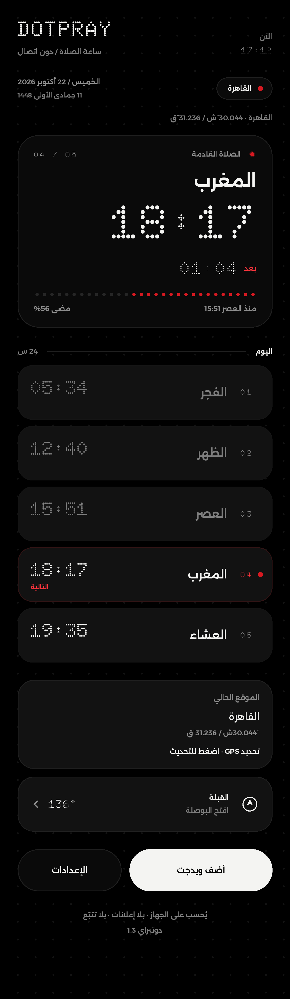
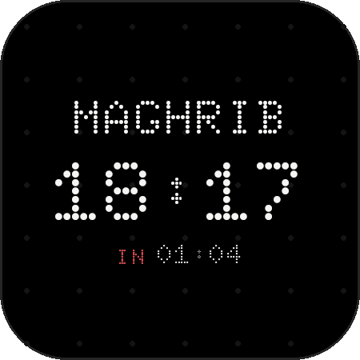
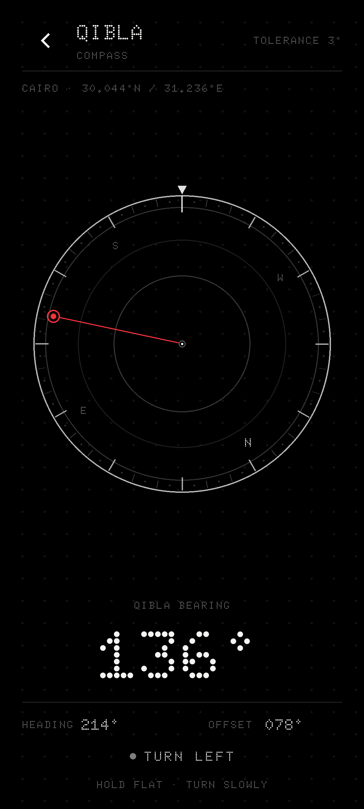
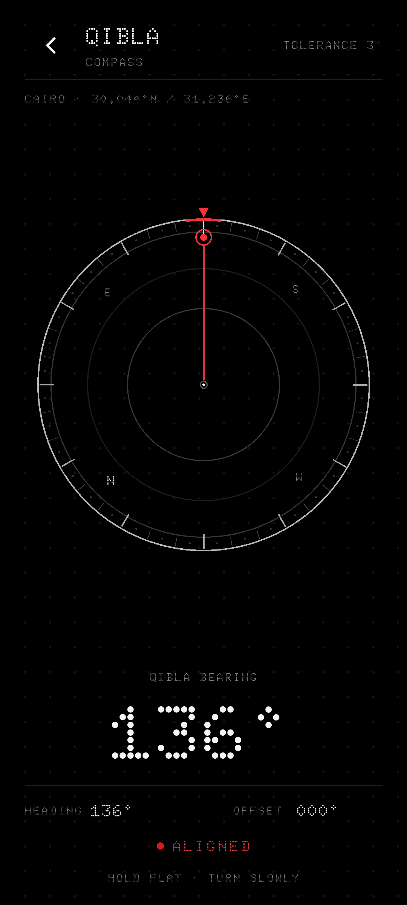
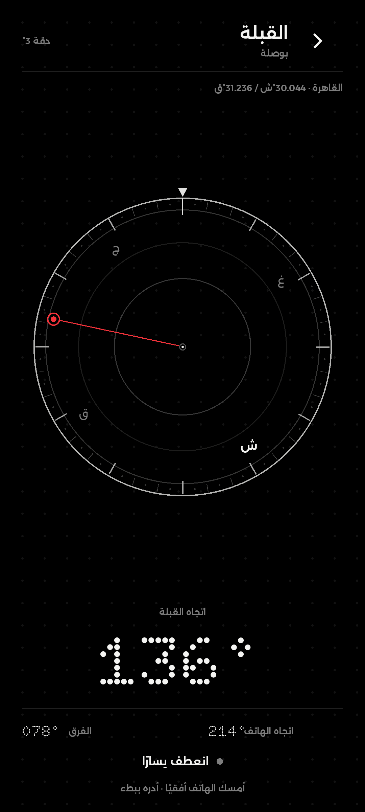

# Dotpray

A Nothing OS–styled Android prayer clock, built around a **home-screen widget**.

Monochrome dot-matrix aesthetic, one red accent, everything computed on device.
No ads, no tracking, no AndroidX. The app has no `INTERNET` permission.

<p align="center">
  
</p>

<p align="center">
  
  
  
  
  
  
</p>

<p align="center">
  
  
  
</p>

*Previews are design mock-ups drawn to mirror the real layouts and palette
(`tools/render_preview.py`), not screenshots. The app and all three widget
layouts share the in-app System / Light / Dark choice; the Qibla compass follows
that choice too, with the dark rendering shown here as the primary instrument
surface.*

*Version 1.3 — Arabic and English, natural Arabic typography, post-Adhan grace,
three resizable widget layouts, and dotted progress rails.*

*1.3 also adds the Qibla compass and per-widget **Widget Settings** with a
continuous transparency level. Prayer calculations, alerts and the default
widget rendering remain unchanged; release notes are under **1.3** in the
changelog.*

## What's new in 1.3

These are the features added since 1.2. The existing prayer engine,
calculations, alarms, storage and offline manifest are unchanged.

* **Choose the app language.** Settings has an **App Language** row with
  **العربية** and **English**. The choice is saved independently of the phone's
  system language, English remains the default, and switching rebuilds the
  screen in the selected direction: RTL for Arabic, LTR for English.
* **A fully Arabic app and every widget.** Arabic is no longer decoration: the
  selected language supplies the prayer names, labels, dates, place names,
  notification copy, accessibility text and elapsed sentence. Arabic uses
  [Alexandria](https://fonts.google.com/specimen/Alexandria) Regular and
  SemiBold (SIL OFL), bundled in `res/font`; Doto still sets prayer times,
  countdowns and the English display. Arabic text is set at a slightly smaller
  optical size than English so labels, prayer names, dates and buttons carry
  the same visual weight in both languages. There is no dotted Arabic
  treatment, no letter-spacing and no runtime font download.
* **The prayer stays current after the Adhan.** Fajr, Dhuhr, Asr and Isha stay
  active for 15 minutes; Maghrib for 10. The app hero, the wide widget and both
  compact widgets show `PRAYER NOW` / `الصلاة الآن` with a localized elapsed
  sentence during that window, then switch to the following prayer and start
  its countdown at zero. Progress is 100% during grace and exactly 0% at the
  next Adhan, including Isha → Fajr across midnight, restarts, clock jumps and
  time-zone changes. At extreme latitudes the grace is capped at the next Adhan
  so no prayer is skipped.
* **Three resizable widgets.** The wide card defaults to 4×2, the small card to
  3×3 with a dotted progress rail, and the new minimal card to 2×2 without the
  rail. Each has its own provider, and all three keep horizontal and vertical
  resize handles. The wide card drops its schedule and date lines when it is
  resized short instead of shrinking them out of legibility. The in-app
  **ADD WIDGET** button opens a three-option sheet — *Small — 3×3*,
  *Minimal — 2×2* or *Wide — 4×2* — and pins the matching provider directly.
* **A calmer wide card.** The wide layout now uses a measured four-row grid:
  the clock aligns with the prayer name, the Gregorian date with the prayer
  time, and the Hijri date with the countdown. The wide hero uses a 22 sp name,
  35 sp time, 22 sp clock and 14 sp countdown; the schedule uses 10 sp names
  and 15 sp times, with five equal-width cells. Rows are spaced from glyph ink
  rather than a baseline grid, so the English and Arabic stacks keep the same
  optical breathing room.
* **Dotted progress.** The app hero, the wide widget and the small 3×3 widget
  replace the solid rail with evenly spaced 2 dp dots at a 9 dp pitch.
  Completed dots use the red accent, remaining dots the quiet track colour, and
  the row fills from the right in Arabic and from the left in English. The
  minimal 2×2 card omits the rail by design. The wide rail is optically centred
  between the countdown and the prayer strip.
* **RTL that lines up.** The DOTPRAY wordmark and tagline stay on the left in
  both languages, the Settings and Add Widget buttons share one 52 dp row
  (42% / 58%), and the Current Location card lines up with the prayer cards in
  RTL and LTR. Arabic uses **ويدجت** throughout.
* **In-app credit.** Settings → About names **Muhammad Attia** (development
  and design) in both languages.
* **Minute precision.** The app clock, countdown and every widget show `HH:MM`
  only. Removing the seconds also removes the two live `ViewFlipper` overlays
  and the 120 generated glyph drawables, so the app's UI ticker runs once a
  minute and the widget repaints on the minute boundary.
* **A quieter colon.** The colon glyph in the bundled Doto faces is reduced to
  45% and re-centred on the digit body, while keeping Doto's normal advance, so
  `18:17` and `01:04` read as numbers first in the app and every widget.

---

## Qibla compass

The **QIBLA** row under Current Location opens a dedicated live compass. It is
a precision surface, not a map: a north-up dial, one red Qibla needle, and the
bearing set in large Doto figures.

* **A real sensor compass.** The heading comes from the rotation-vector sensor,
  or from the accelerometer + magnetometer pair on devices without one. A
  60 ms shortest-arc filter keeps the dial calm; every frame still follows the
  live reading.
* **True north, not just magnetic north.** The local geomagnetic declination is
  applied before the heading is shown, so the white **N** marker and the red
  Qibla needle share the same true-north reference as the calculated bearing.
* **One red mark.** At rest, the Qibla needle and tip ring are the only red on
  the dial. North is a longer white tick and a white letter; east, south and
  west stay quieter in grey. Alignment adds a short red rim segment and turns
  the fixed top index red.
* **A clear alignment state.** Within 3° of the Qibla, the top rim gains a short
  red segment, the top index turns red, the state line reads **ALIGNED**, and a
  single haptic tick confirms it. The release threshold is slightly wider so
  the state does not flicker at the edge.
* **Honest sensor states.** A low-accuracy magnetometer replaces the hint with
  **CALIBRATE · MOVE PHONE IN A FIGURE 8**; a missing or silent sensor keeps the
  bearing readable and says **BEARING ONLY** rather than pretending to be live.
* **No new permissions.** The screen reuses the saved place; it does not request
  location or touch the network. If the app is still on its Cairo default, the
  place line carries a **DEFAULT** tag beside the coordinates.
* **Part of the app, not a separate app.** It follows the app language (full
  Arabic RTL with Alexandria) and the System / Light / Dark choice, and has a
  landscape layout that keeps the dial and readout side by side. Back returns to
  the unchanged prayer screen.

The dial is built from four thin rings, 5° dot markers, 10°/30° spokes, upright
cardinal letters and a needle that passes behind their clear discs. There are no
gradients, shadows, illustrations or decorative motion.

---

## Credits

- **Muhammad Attia** — development and design — [@Muhattia](https://github.com/Muhattia)

Project: [github.com/Muhattia/dotpray](https://github.com/Muhattia/dotpray)

---

## Installing

Download the latest signed APK from the repository's **Releases** page, or
build it locally with `./build.sh`:

```bash
./build.sh
adb install -r dist/dotpray-1.3.apk
```

Or copy the built APK to the phone and open it (you will need to allow
"install from unknown sources" once).

The APK is **universal**: the app is pure Java with no native libraries, so the
same file runs on 32-bit and 64-bit ARM devices, and on x86 emulators. The only
floor is Android 8.0 (API 26), not the CPU architecture. `build.sh` audits this
and refuses to ship an APK that carries native code for only one half of an
architecture family.

**Adding a widget:** long-press an empty spot on the home screen → *Widgets* →
*Dotpray* → drag out **Prayer (wide)** `4×2`, **Prayer (small)** `3×3` or
**Prayer (minimal)** `2×2`. All three picker labels follow the app language.

Or use the **ADD WIDGET** button inside the app. It opens a three-option sheet —
*Small — 3×3*, *Minimal — 2×2* or *Wide — 4×2* — and asks the launcher to pin
that provider for you. Every layout keeps resize handles, so it can be made
wider or taller after pinning. The wide card switches to a compact hero when
it is resized too short for the schedule strip; the compact cards scale their
centred stack into the available cells.

**Changing a widget's appearance:** the first time a widget is placed, the
launcher opens **Widget Settings**, with a live preview, a **TRANSPARENCY** bar
from **0%** to **100%**, a live percentage, **Apply** and **Cancel**. To revisit
it on Android 12 or later, long-press the widget and choose *Edit* / *Widget
settings*. The same screen stays available through the launcher's configuration
entry on older releases when the launcher supports one; launchers that do not
expose reconfiguration require removing and adding the widget again. There is
no invented custom long-press action: all entry points use the standard
`android:configure` / `widgetFeatures="reconfigurable"` contract. The level
applies only to the widget you opened, not to the app, the Qibla screen or the
other placements.

At **0%** the widget is the shipped Dotpray card. As the level rises, the card
fill, border and background dot field fade together; at **100%** those layers
are not drawn at all and the wallpaper shows through. Text, prayer times, the
clock, countdown, red indicators and the full tap target stay fully opaque at
every level, with a crisp outline that strengthens as the card clears
instead of a blurred halo; the quiet part of the progress rail is strengthened
for the same reason. From **80%** upward the type switches to the wallpaper-safe
light ink used by the night theme, so a clear light-theme widget never becomes a
dark-on-dark ghost. The bitmap is painted at the upper bound of the launcher's
reported cell size, with a small oversample, and downscaled by the host, so dots
and type stay sharp rather than being stretched from a minimum-width paint. The
`ARGB_8888` bitmap carries real alpha rather than painting the wallpaper colour.
Every update also resets both RemoteViews containers to transparent, so a
background left by an older build on a recycled launcher view cannot survive an
XML-only change. The preview sits on a wallpaper sample, not on another card, so the difference
is visible while dragging. If a particular launcher paints its own card, shadow
or padding around every widget, that launcher-owned surface can still be
visible behind the fully clear layout.

The wall clock, countdown and prayer times use minute precision. The widget
bitmap (next prayer, dates, header and prayer strip) redraws on every minute
boundary, on every prayer boundary, when the launcher reports a new cell size,
on boot, whenever the clock or the time zone changes, and immediately when the
app's theme, language or location changes.

Prayer alerts use a separate alarm from the widget roll-over. The alert is
booked for the prayer time (exact when the OS grants exact-alarm access, with
`setAndAllowWhileIdle` as the fallback); the widget alarm fires shortly after
and never cancels a waiting alert.

---

## Building

There is **no Gradle wrapper and no Android Gradle Plugin** in this repo. The
build is a straight pipeline of the platform tools, which keeps it reproducible
on any machine that has an Android SDK and a JDK:

```bash
SDK=/opt/android-sdk JAVA=/opt/jdk ./build.sh
```

`build.sh` runs:

```
aapt2 compile  →  aapt2 link  →  javac  →  d8  →  zip  →  zipalign  →  apksigner
```

Requirements:

| Tool | Version used here |
|---|---|
| JDK | 17 (Temurin) |
| Android platform | `android-37.0` (`android.jar`) |
| Build tools | `37.0.0` |
| minSdk / targetSdk | 26 / 35 |

Output: `dist/dotpray-1.3.apk`, signed with a debug key that is generated on
first run at `keystore/dotpray.keystore` (outside `build/`, so rebuilds keep the
same certificate and new versions install over old ones). Set `APK_NAME` to
build a side-by-side test APK without touching an existing release artifact:

```bash
SDK=/opt/android-sdk JAVA=/opt/jdk APK_NAME=dotpray-1.3-test.apk ./build.sh
```

Two details worth knowing if you touch the build:

* Java sources are compiled with `javac --release 8 -classpath android.jar`,
  **not** `-bootclasspath`. With `-bootclasspath` the lambdas fail to resolve
  (`cannot find symbol: method metafactory`); with `--release 8` the Java 8 API
  surface is enforced and D8 desugars the lambdas afterwards.
* `Api30.java` is deliberately the only file that touches API 30 APIs, and it
  is compiled against the API 37 `android.jar`. Every other source file
  compiles cleanly against a real **API 26** `android.jar`.

---

## How the times are computed

`prayer/PrayerCalculator.java` implements the NOAA solar position algorithm:

1. Equation of time and solar declination from the mean longitude, mean anomaly
   and the corrected obliquity of the ecliptic.
2. True solar noon: `720 − 4·longitude − EoT` minutes after `00:00 UTC`.
3. Hour angle for each twilight depression:
   `cos H = (sin h − sin φ · sin δ) / (cos φ · cos δ)`, offsets `±4·H` minutes.
4. Asr from the shadow length: `tan h = 1 / (shadowFactor + tan|φ − δ|)`.
5. Sunrise/sunset use the standard `-0.833°` refraction-corrected altitude.
6. Everything is computed in UTC and converted to local time at the very end,
   so a DST boundary can never shift a prayer by an hour.

**High latitudes.** When the sun never reaches the requested depression (the
midnight sun region), Fajr and Isha fall back to *one seventh of the night*,
counted from sunrise and sunset.

**Method.** Dotpray always uses the Egyptian General Authority of Survey:
`Fajr 19.5°` and `Isha 17.5°`. There is no method picker.

### Validation

The engine was cross-checked against **three independent implementations** over
6 cities × 5 dates × 5 prayers (150 comparisons per reference):

| Reference | Result |
|---|---|
| `adhan` (Python, Spencer declination) | **max 4 min**, typically ≤ 2 min |
| `aladhan.com` API | **± 2 min** everywhere except 4 polar cases |
| PSA / Blanco-Muriel solar model (Asr only) | **≤ 1 min** |

The residual differences are the equation-of-time model (NOAA vs Spencer) and
the deliberate one-minute safety margin added to Dhuhr.

The polar outliers are genuine methodological differences, not bugs: the API
applies its own "angle based" extreme-latitude rules, while Dotpray uses the
one-seventh-of-the-night rule. In London in early July the sun never reaches
19.5° below the horizon, so Fajr is undefined and Dotpray falls back to the
one-seventh rule. A third model (PSA) independently confirms that Dotpray's Asr
time in Reykjavik in midwinter is the correct one.

Reproduce it yourself:

```bash
javac --release 8 -encoding UTF-8 -d /tmp/tt -cp build/classes tools/TestTimes.java
java -cp /tmp/tt:build/classes TestTimes
```

### Grace, language and widget-layout tests

Both harnesses are plain JVM programs — no JUnit, no emulator, no Android
device. They exit non-zero on the first failing check and are intentionally not
packaged in the APK.

`tools/TestGrace.java` covers the language rules (`normalize`, default English,
RTL, locale, display casing), the five grace durations, exact 15-minute and
10-minute boundaries, progress 100% → 0%, Isha crossing midnight, the capped
grace at extreme latitudes, stable notification keys, every widget model, the
resizable 326 × 150 dp / 150 × 150 dp geometry with its short-wide fallback,
and the shared dotted-rail direction rules:

```bash
SDK=/opt/android-sdk JAVA=/opt/jdk ./build.sh
javac --release 8 -encoding UTF-8 -cp build/classes -d build/test \
    tools/TestGrace.java
java -Dfile.encoding=UTF-8 -cp build/classes:build/test \
    com.dotpray.app.prayer.TestGrace
```

`tools/TestLocale.java` reads `values/`, `values-ar/`, `arrays.xml`, every
layout and the manifest directly. It checks string/plural parity, placeholder
positions, Arabic singular/dual/plural forms, localized place names, hardcoded
copy, the Alexandria font files and OFL licence, the resizable 4×2 / 3×3 /
2×2 widget metadata, the three-option chooser, the per-widget configuration
contract, the 0–100 transparency storage and renderer branches, the About
credits, logo and location-card alignment, the Arabic **ويدجت** terminology,
dotted-rail wiring and RTL, and that the old Almarai/dotted-Arabic
implementation is gone:

```bash
javac --release 8 -encoding UTF-8 -d build/test tools/TestLocale.java
java -Dfile.encoding=UTF-8 -cp build/test TestLocale
```

`tools/TestQibla.java` covers the angle rules behind the compass: 0–360
normalization, shortest-arc turn direction, the 3° alignment test, east/west
declination, zero-padded readings, the Cairo and London Qibla bearings, and the
heading filter across north and after a long sensor gap:

```bash
javac --release 8 -encoding UTF-8 -cp build/classes -d build/test \
    tools/TestQibla.java
java -cp build/classes:build/test com.dotpray.app.prayer.TestQibla
```

At the time of writing: **185 checks** in `TestGrace`, **763 checks** in
`TestLocale`, **34 checks** in `TestQibla`, and the numeric `TestTimes` harness
all pass.

---

## Project layout

```
dotpray/
├── build.sh                     manual aapt2 → javac → d8 → apksigner pipeline
├── design/dotpray-icon.svg      traced launcher-icon source
├── app/src/main/
│   ├── AndroidManifest.xml
│   ├── java/com/dotpray/app/
│   │   ├── MainActivity.java    single screen, countdown ticker, location
│   │   ├── QiblaActivity.java   live Qibla compass screen
│   │   ├── Api30.java           the only API-30 specific code
│   │   ├── Perm.java            POST_NOTIFICATIONS literal (API 33+)
│   │   ├── prayer/              PrayerCalculator, PrayerClock, PrayerNames, ElapsedText, Hijri, Qibla, CompassMath
│   │   ├── ui/                  DotFieldView, PulseDotView, QiblaCompassView, ProgressLineView, ProgressDots, WidgetSizeDialog
│   │   ├── widget/              WidgetModel, WidgetLayout, providers, renderer, updater, WidgetConfigActivity, WidgetPrefs, alarms
│   │   ├── alerts/              AlarmManager scheduling + localized notifications
│   │   └── data/                Language, LocaleController, Place, PlaceNames, UiText, PrayerPrefs, ThemeController, Format
│   └── res/                     layouts, values + values-ar, dot-matrix drawables, Doto + Alexandria fonts
├── tools/
│   ├── TestTimes.java           JVM harness that prints the computed times
│   ├── TestGrace.java           JVM tests for language, grace, grammar and widget geometry
│   ├── TestLocale.java          JVM audit of every localized resource, layout and font
│   ├── TestQibla.java           JVM tests for bearings, turns, alignment and sensor smoothing
│   ├── check_widget_layouts.py  validates the three widget metadata files
│   ├── shrink_colon.py          reduces and re-centres Doto's colon glyph
│   ├── make_icons.py            regenerates launcher icons from the SVG
│   ├── make_aso.py              builds the Google Play listing graphics
│   └── render_preview.py        renders preview/*.png from the real layouts
├── aso/                         Play Store copy, screenshots, graphics, policy
└── dist/dotpray-1.3.apk
```

### Design details

* **Typeface.** Latin copy, prayer times and countdowns are set
  in [Doto](https://fonts.google.com/specimen/Doto) (SIL Open Font License 1.1),
  instanced to static regular/bold/black weights. Arabic copy — including
  numbers embedded in an Arabic label, such as a date or the elapsed sentence —
  is set in [Alexandria](https://fonts.google.com/specimen/Alexandria) Regular
  and SemiBold, also SIL OFL. The geometric Alexandria skeleton sits close to
  Nothing's typography without pretending to be Doto. Arabic sizes are set
  roughly 10–25% smaller than their English equivalents, because Alexandria's
  Arabic body is taller than Doto's dot cap height at the same point size;
  `values-ar/dimens.xml` and `WidgetRenderer.ARABIC_TEXT_SCALE` keep the two
  languages optically equal. Doto's colon is reduced to 45% and re-centred on
  the digit body while keeping its normal 600-unit advance, so time separators
  stay quiet without opening gaps in the number; `tools/shrink_colon.py`
  reproduces that patch. Both faces are bundled; there is no system font and no runtime
  download. Licences: `app/src/main/assets/OFL-Doto.txt` and
  `OFL-Alexandria.txt`.
* **Arabic shaping.** `values-ar/` supplies ordinary Arabic strings, styles
  switch the label face to Alexandria with zero letter-spacing, and Android's
  HarfBuzz/ICU stack handles joining, ligatures and bidi. Nothing inserts,
  reverses or shapes Arabic manually. Numeric styles deliberately keep Doto,
  so times and countdowns match the English presentation; counts and
  percentages inside localized copy are also formatted with Latin digits, even
  when the phone itself is set to Arabic. The app and widgets mirror their
  layouts through `supportsRtl` / `LayoutDirection.RTL`, and the dotted
  progress rail advances from the right. Screen readers receive the same
  localized text through the normal resource lookup.
* **The Qibla dial.** `ui/QiblaCompassView.java` draws the instrument rather
  than composing it from images: four thin rings, 5° dot markers, 10°/30°
  spokes, an upright cardinal set and a red needle that passes behind the
  letter masks. The dial rotates by the inverse of the true heading, so the
  fixed top index always names the direction the phone is facing; the Qibla
  needle stays on its absolute bearing. The alignment state is a short red rim
  segment and a red top index, with a 180 ms fade or an instant cut when the
  system disables animations. `prayer/CompassMath.java` owns normalization,
  shortest-arc turns, tolerance and the 60 ms heading filter; the activity
  applies the local declination and falls back to accelerometer + magnetometer
  when no rotation-vector sensor exists. The screen follows the app's Light /
  Dark choice: near-black in dark, technical paper in light, always a single
  red Qibla mark. It is an Activity, not a RemoteViews surface, so the widgets
  and their bitmap renderer are untouched.
* **Grace state.** `PrayerClock.Snapshot` keeps the scheduled `previous` and
  `next` instants and derives `graceEnd`, `graceActive()`, `elapsedMinutes()`,
  `displayAt()` and `nextGraceEndMs()` from the wall clock. `WidgetModel`
  packages the same decisions for every widget variant and the app hero, so a
  restart, a clock jump or a location change cannot leave a counter behind.
  The elapsed sentence comes from plural resources in both languages; Arabic
  uses the full six-form grammar — `لحظات`, `دقيقة واحدة`, `دقيقتان`,
  `3–10 دقائق`, then `11+ دقيقة` — with the prayer name in every form.
* **Next-prayer progress.** `PrayerClock.Snapshot.progress()` maps the interval
  from the end of the active grace period to the next Adhan into 0..1. It is
  100% throughout the grace window and exactly 0% at the boundary where the
  next prayer becomes the display. The app hero and the wide and small widgets
  draw the same segmented rail via `ProgressDots`: 2 dp circles, 9 dp pitch,
  accent for the completed part and `track` for what remains, filling from the
  right in Arabic and from the left in English. The minimal widget omits the
  rail. The app advances it on the minute boundary; the widgets advance it on
  their minute refresh and book a separate non-wakeup alarm for the grace
  boundary.
* **The widget is mostly a drawing.** `widget/WidgetRenderer.java` composes
  the static card on a `Canvas` at the exact pixel size the launcher reports
  and pushes it with `setImageViewBitmap`. The wide composition is authored in
  a 326 × 160 dp space and the compact compositions in a 150 × 150 dp space,
  then scaled uniformly into the launcher's cells. A short wide widget
  switches to a 104 dp hero and drops the dates and schedule strip instead of
  shrinking every line. The compact cards are one centred name/time/countdown
  stack; the small one has the dotted rail underneath, the minimal one does
  not. During a grace their two localized lines replace the countdown and the
  small card's rail moves down. The wide card uses a two-column hero: the
  displayed prayer on the primary side; location, wall clock and dates on the
  other; the five-prayer strip across the bottom. Arabic mirrors the whole
  composition, including the schedule order and dot direction. All three
  providers declare `resizeMode="horizontal|vertical"` with target cells and
  readable resize bounds. All geometry lives in `WidgetLayout` and is checked
  by the JVM tests. The whole card is one click target (`wRoot`); appearance is
  chosen from the standard launcher configuration screen, and saved per
  placement by `WidgetPrefs` rather than globally. This is what guarantees Doto
  on One UI, where `@font` inside `RemoteViews` is ignored. The clock and
  countdown are painted into the same bitmap and refreshed on the minute
  boundary.
* **Notifications** use an exact alarm at the prayer instant when the platform
  allows it, with `AlarmManager.setAndAllowWhileIdle` as the fallback. The
  title, body, place name and channel name/description resolve from the
  selected language at send time. The alert and the widget refresh are
  separate alarms, so a widget tick cannot cancel a pending prayer alert.

---

## Google Play assets

The Play Store listing copy, five phone screenshots, feature graphic, 512 px
icon, privacy policy and Data safety draft are in [`aso/`](aso/). Start with
[`aso/README.md`](aso/README.md).

---

## API level support

The app targets `minSdk 26` (Android 8.0) and has been verified to compile and
link against a real API 26 `android.jar`.

The clock and countdown use `HH:MM` on every supported version. The widget no
longer depends on the Android 12 `RemoteViews` layout-placement APIs or on
launcher-driven second views; it repaints from the app on the minute boundary.

Two things that Android 8.0 does *not* have, and how they are handled:

* `java.time.ZonedDateTime.toInstant()` / `toEpochSecond()` are missing from
  Android 8.0's `java.time`. The conversions go through
  `LocalDateTime#toEpochSecond(ZoneOffset)` instead.
* `Window.setDecorFitsSystemWindows()` and `WindowInsets.Type` are API 30.
  They live in `Api30.java`, which is only ever loaded on Android 11+, so
  Android 8 verifies and runs the app cleanly.

---

## Privacy

No analytics, no ads, no crash reporting, no network permission at all. The
only data the app stores is your last location and its name, app language,
theme choice, Asr school, clock format and alert preference — in a private
`SharedPreferences` file on the device.
